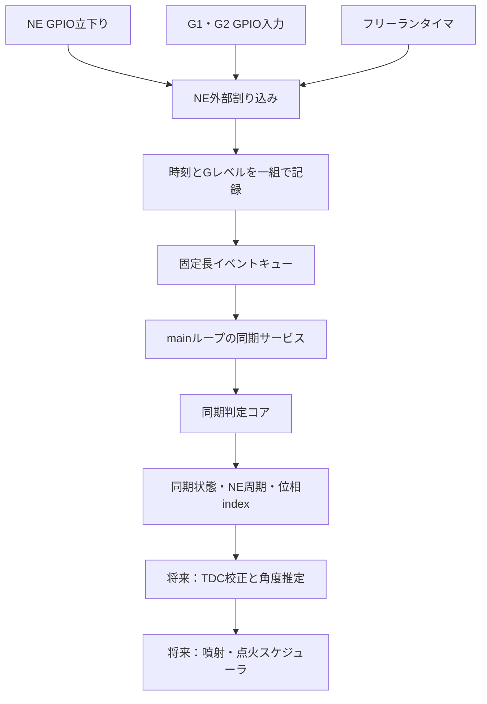

# 4E-FTE ECU ソフトウェア設計書

## 1. 目的と適用範囲

2026-10-18の合意に基づき、NE・G1・G2のGPIO入力から同期判定までの実装方針を定める。[要求仕様書](ECU_Requirements_Specification.md)を満たすための構成、実行場所、データの受け渡し、時間条件を記載する。波形の解釈と方式検討の経緯は[NE・G同期方式の検討](NE_G_Synchronization_Study.md)、ホスト試験の実行方法は[tests/README.md](../tests/README.md)を参照する。

GPIO割り込み・イベントキュー・mainループの接続は、ベンチ用ビルドオプションで実装した。通常ビルドでは取得を有効にしない。実装とホスト試験、実機での検証完了は区別する。噴射・点火の出力許可や同期喪失時の出力動作は要求仕様書に従い、本書では未決定事項を補完しない。

## 2. 全体構成と実行場所

NEの立下りごとにGPIO外部割り込みを発生させ、割り込み内でG1/G2を取得する。Gのレベルで別の割り込みへ移る構成ではなく、同じNE割り込み内で入力結果を分類する。G1/G2自身のエッジ割り込みは使用しない。



| 構成要素 | 実行場所 | 責務 | 状態 |
|---|---|---|---|
| 初期化 | main、NE割り込み有効化前 | 設定検証、コア・キュー・取得層の初期化 | ベンチ用接続を実装済み |
| NE入力取得 | GPIO外部割り込み | 時刻・Gレベル取得、キューへの追加、入力欠落の通知 | ベンチ用接続を実装済み |
| イベントキュー | 割り込みが書込み、mainが読取り | イベントの順序と対応関係を保持 | 実装済み |
| 同期サービス | mainループ | イベント処理、停止判定、欠落通知、結果公開 | 実装済み、出力連携は未実装 |
| 同期判定コア | 同期サービスから直列呼出し | 24歯の位相追跡と同期の確立・無効化 | 実装済み |
| TDC校正・出力予約 | 将来の制御処理 | 校正後角度への変換とタイマによる出力実行 | 未実装 |

同期判定コアのAPIはすべてmain側から呼ぶ。割り込みから同じ`EngineSync`を更新しない。割り込みではGPIO取得とイベント保存に必要な処理に限定し、ログ出力、ADC待機、燃料計算、同期デコーダの実行を行わない。

## 3. GPIO入力取得層

### 3.1 入力と時刻の取得

NEを立下り外部割り込み、G1/G2を通常のGPIO入力とする。全NEエッジを記録し、G2がLowのイベントも捨てない。G1=PB8、G2=PB9は既存の候補であり、最終ピン選定とGPIO設定は別途行う。

割り込みの入力取得処理ではフリーランタイマのカウンタを読み、続けてG1/G2を取得する。両Gが同じGPIOポートなら、入力レジスタを1回読み、その値から両ビットを抽出する。別ポートの場合は2回の読取りの時刻差も評価対象とする。

GPIO方式で保存できる時刻は、厳密なNEエッジ時刻ではなく割り込み内でタイマを読んだ時刻である。前案のタイマ入力キャプチャによるハードウェア時刻保存は今回の基本構成では採用しない。コアには取得した同一単位の時刻を渡すが、割り込み遅延・その変動・GPIO読取りとの時間差は取得層の誤差として管理する。

NE割り込みからGの取得完了までの間、対象Gのレベルが安定しているよう入力回路を設計する。対象歯の前にHiになり、取得完了まで保持し、隣接するNE歯では同じGをHiとして検出しないこと。GPIO外部割り込みはGの過去のレベルを保存しないため、main側でGPIOを読み直して代用しない。

### 3.2 Gレベルの分類

| G1 | G2 | コアへ渡す値 | 意味 |
|---|---|---|---|
| Low | Low | `SYNC_G_NONE` | 通常のNE歯 |
| Hi | Low | `SYNC_G1` | G1基準歯の候補 |
| Low | Hi | `SYNC_G2` | G2基準歯の候補 |
| Hi | Hi | `SYNC_G_INVALID` | 不正な入力 |

取得結果が信頼できないことを検出した場合も、不正入力または入力欠落として通知する。現在のコアの不正入力値は`SYNC_G_INVALID`であり、両Hiと取得異常の診断上の区別は取得層で記録する。

### 3.3 入力イベント

取得層は`engine_sync_service.h`の`SyncInputEvent`に次を保存する。

| フィールド | 内容 |
|---|---|
| `tick` | NE割り込み内で取得した32 bitタイマ値 |
| `marker` | 同じNEイベントに対応するGレベル分類 |
| `generation` | 入力欠落後の復旧前後を識別する世代番号 |

時刻とG分類を別々のキューに分けない。割り込み内で同期コアへ渡すイベントを先に選別せず、周期妥当性やGの並びはコアで判断する。

## 4. イベントキューと排他制御

固定長リングバッファを使用する。生産者はNE割り込みの1か所、消費者はmainの同期サービスの1か所とし、動的メモリ確保は使用しない。

- 割り込み側はイベント全体を書いた後に書込み位置を公開する。
- main側は公開済みのイベントだけを取得する。
- 初期実装では、mainのイベント取出しと共有フラグの取得に短いクリティカルセクションを用いる。元の割り込みマスク状態を保存して復元し、各NEの同期判定やキュー全体の消化中は割り込みを止めない。空キューでの停止判定、欠落復旧、状態のコピーは短い排他区間内で行う。
- `volatile`だけでイベントの一貫性や競合の解決を保証したことにはしない。
- キュー満杯では未読イベントを上書きせず、入力欠落をラッチし、欠落数を記録する。

容量は最低でも`ceil(最大入力周波数 × mainが取出せない最大時間) + 余裕分`のイベントを保持できるよう選ぶ。NE=12パルス／回転、7000 rpmでは1400イベント／秒である。例えば10 msの空白には14イベント分が必要だが、これは容量決定値ではない。ノイズによる追加エッジ、実効容量、割り込み負荷も評価して確定する。

ベンチ実装は64件をすべて保持できるリングバッファとした。7000 rpmの正常NEなら約45.7 ms分である。ADCの試作処理は1回の変換待ちが最大10 msで4回あるため、その前後でサービスを実行する。ADC再設定等も含めた実測時間は未確認であり、64件を実機用の確定容量とはしない。1回のサービスは最大64イベントで打ち切り、mainの他処理へ戻る。

入力欠落を検出した場合は、mainが短いクリティカルセクションでキュー破棄・世代更新・欠落フラグ取得を行う。続いてmainから`engine_sync_capture_loss()`を呼び、取得した位相を無効化する。欠落前の残存イベントで再同期しない。欠落通知はmainで処理するまで保持し、復旧後の新しい世代のイベントから取得をやり直す。復旧手順と並行して到着するイベントも世代により識別する。

## 5. main側の同期サービス

### 5.1 初期化

1. タイマ周波数、NE周期上下限、固定停止時間を設定する。
2. `engine_sync_init()`の成功を確認する。
3. キュー、取得世代、欠落情報を初期化する。
4. GPIOとタイマの準備後、残存する割り込み要求を適切に処理してNE割り込みを有効化する。

ベンチ構成ではNE=PC6、G1=PB8、G2=PB9、TIM5=1 MHz、32 bitフリーランとする。APB1タイマクロックからプリスケーラを計算し、1 MHzを生成できない設定や想定外のTIMPRE設定は初期化失敗とする。NEはEXTI9_5のうちline6を使用し、このハンドラを当該入力用に使用する。他のline5〜9を追加する際は共有ハンドラの拡張が必要となる。優先度グループは4、NE優先度は1、既存TIM2は2とし、NEがTIM2処理に割り込める構成とする。

ベンチの周期上下限は500〜100000 µs、停止時間は250000 µsとした。実機用の確定値ではない。`min_period_ticks > 0`、`min_period_ticks <= max_period_ticks < stop_timeout_ticks < 2^31`が現コアの設定条件である。試験用数値を実機の既定値として流用しない。

### 5.2 イベント処理と停止判定の順序

次の順序を同期サービスの基本形とする。キュー・世代管理・停止判定を実装済みであり、上位への通知は停止回数・同期喪失回数として記録する。出力制御への通知と予約取消しは未実装である。

```text
入力欠落がラッチされていれば:
    キューを破棄し、取得世代を更新
    engine_sync_capture_loss()

現在処理する範囲のイベントを古い順に取り出す:
    入力欠落のラッチがあれば処理を中断し、欠落復旧へ戻る
    イベント世代が現在の取得世代と一致することを確認
    engine_sync_poll(event.tick)
    停止遷移があれば上位の停止処理へ通知
    engine_sync_tooth(event.tick, event.marker)
    同期状態の遷移を上位へ通知

割り込みとの短い排他区間で:
    キューが空であることを確認し、現在時刻を取得
    空なら、その時刻までengine_sync_poll()を実行
同期結果を公開
```

処理中や結果公開前にも欠落通知を確認し、検出後に欠落前の位相を最新の有効結果として公開しない。割り込みから通知されてmainが反映するまでの最大遅延も、サービス周期の評価に含める。

各イベントを渡す前にも、そのイベント時刻で停止判定する。これにより、mainが停止前後のイベントをまとめて受け取っても、長い空白を挟んだ新しいNEを古い周期履歴で処理しない。

未処理イベントより未来の現在時刻を使って先に停止判定すると、処理遅延を入力停止と誤認するため、通常の現在時刻での停止判定はキューを処理した後に行う。空確認と時刻取得の競合も防ぐ。処理件数に上限を設けてmainの他処理へ戻る場合は、イベントが残る状態で現在時刻の停止判定を行わない。

停止通知と同期喪失通知は区別する。現在のコアは通知コールバックを持たないので、同期サービスが呼出し前後の状態を比較する。初回NE以前は`have_ne=false`であり、`SYNC_SEARCH`への遷移だけで停止を判定しない。停止では`have_ne`がtrueからfalseへ変わり、`fault=SYNC_TIMEOUT`になる。噴射周期カウンタ等の初期化は上位制御側の責務とする。

### 5.3 公開する結果

main内の制御処理へ、`SyncStatus`として同期状態、歯番号、NE周期、最後の有効NE時刻、異常理由、入力欠落情報、キュー占有数と最大占有数、停止回数、同期喪失回数、復旧回数を渡す。`engine_sync_board_status()`はmain側から呼ぶ。`tooth`を確定した720°位相として使えるのは`state == SYNC_LOCKED`の場合だけである。`fault`は過去の異常理由を保持することがあるため、`fault == SYNC_OK`だけで同期成立を判断しない。欠落がラッチされていて復旧処理が未実行の場合も、取得する状態のコピーは位相無効として返す。

`dropped_events`は割り込み側で保存できなかったイベントの累積数であり、復旧時にまとめて破棄した未読キュー件数は含めない。`recoveries`と`generation`で破棄・再取得の発生を区別する。診断用の累積カウンタは最大値で飽和させ、取得世代は32 bitで循環する。

将来、出力割り込み側から結果を参照する場合は、別の一貫したスナップショットとして公開する。`EngineSync`の内部状態を複数の実行文脈から直接読み書きする設計にはしない。

## 6. 同期判定コア

実装は[engine_sync.h](../Core/Inc/engine_sync.h)と[engine_sync.c](../Core/Src/engine_sync.c)にある。HALに依存せず、GPIO操作・出力操作・ログ処理を行わない。

| API | main側での呼出し契機 | 処理 |
|---|---|---|
| `engine_sync_init()` | 起動時、設定変更時 | 設定検証と全状態初期化 |
| `engine_sync_tooth()` | キューからNEを1件取得したとき | 周期確認、歯の更新、Gの照合 |
| `engine_sync_poll()` | 各イベント直前と入力待ち中 | 固定停止時間の判定 |
| `engine_sync_capture_loss()` | 取得層の欠落通知時 | 位相情報の無効化 |

### 6.1 位相と状態遷移

NEは1歯30°、24歯720°で循環する。G1検出歯をindex=0、G2検出歯をindex=12とする。Gの名称から気筒を固定しない。

| 状態 | 動作 | 次の状態 |
|---|---|---|
| `SYNC_SEARCH` | NE周期を確認し、有効なG1/G2を待つ | G検出で`SYNC_CANDIDATE` |
| `SYNC_CANDIDATE` | 12歯後に異名G、24歯後に同名Gを確認 | 2回の照合成功で`SYNC_LOCKED` |
| `SYNC_LOCKED` | NEごとに位相更新、12歯ごとにG照合 | 正常なら維持 |
| 取得中／同期中 | 不正G、G欠落、周期異常、入力欠落 | `SYNC_SEARCH`へ戻る |
| NE取得後 | 最終有効NEから固定停止時間が経過 | `SYNC_SEARCH`、NE履歴も初期化 |

G1からもG2からも取得できる。異常イベントをそのまま新しい位相基準に流用しない。正常な入力が継続する限り、回転数が500 rpm未満になったことだけでは同期を解除しない。

### 6.2 周期異常と現実装の限界

現コアは固定の周期上下限でNEを評価する。短すぎる／長すぎる周期では同期を解除し、そのイベントで最後の有効NE時刻を更新しない。周期条件を満たすNEでGだけが不正なら、NE時刻は更新した上で位相を無効化する。

周期範囲内に収まる欠落・余分なNEは、次のG照合まで検出が遅れる場合がある。GPIO取得層も、割り込み禁止中の複数エッジをすべて復元できる前提にはしない。コアのホスト試験成功は、実際の入力取りこぼしや全ノイズの検出を保証しない。

## 7. 時間精度と処理期限

時間基準はmainと割り込みで共通とする。32 bit符号なし差分により周回を扱うが、コアへ2^31 tick以上の未処理空白を渡さない。長時間停止後も周期的にサービスを実行し、停止による履歴初期化を済ませる。

7000 rpmの歯間約714 µsを基に、NE割り込みの最悪応答時間、実行時間、mainの最悪処理遅延、キュー占有数を測定する。タイマを仮に1 MHzとした場合、1 tick=1 µsで、7000 rpmでは約0.042°相当だが、割り込み遅延や角度補間誤差は別途加わる。

満たすべき時間条件は、Gの保持期間内にレベル取得を終えること、継続入力でキューをあふれさせないこと、停止通知を許容遅延内に行うこと、将来の出力予約期限に間に合うことである。具体的な許容値・優先度・容量は実測に基づき確定する。mainの定期サービス間隔によって停止通知は固定停止時間から遅れるため、停止時間の設定値と通知の最大遅延を区別する。

## 8. TDC校正と出力制御への境界

位相indexとエンジン角度の変換は別モジュールとする。基準NE歯から次の#1圧縮TDCまでの進行角δを用い、NE歯位置の校正後角度を`(30° × index − δ) mod 720°`とする。校正の有効性を独立に管理し、未校正のδを0°として扱わない。設定変更は停止中に行う。

同期成立、TDC校正済み、出力許可は別の状態である。同期コアは噴射や点火を実行せず、同期喪失時の出力方針も決定しない。将来のスケジューラは校正後角度とNE時刻を用いて出力を予約し、実際の実行時刻はタイマで制御する。mainのGPIOトグルで角度を合わせる構成にはしない。

停止時の噴射停止・予約取消し・各カウンタの初期化は要求仕様書の停止動作を上位制御で実装する。点火および同期喪失時の未確定動作は要求仕様書の残件として維持する。mainや入力取得が停止した場合の独立した監視・出力保護は本接続の実装完了条件とは別に設計する。

## 9. 実装状況と次の検証

実装済みは同期コア、取得・サービス層、ファームウェアへの接続、ホスト模擬入力試験である。`STARLET_SYNC_BENCH=ON`の場合、main初期化から`engine_sync_board_init()`、mainのADC取得前後から`engine_sync_board_run()`を呼ぶ。`EXTI9_5_IRQHandler()`から`engine_sync_board_ne_irq()`を呼び、入力をキューに保存する。コアはサービス層を介してmain側だけで実行する。

`STARLET_SYNC_BENCH`はCMakeオプションで既定OFFとする。ONでは信号発生器用の仮設定で取得を有効にする。入力回路・実機用設定が未確定であることを理由に、通常ビルドで仮設定を自動採用しない。既存CubeMX設定ではPC6は通常入力のままとし、ON時にユーザー実装の取得層がEXTIへ設定し直す。TIM5も取得層で初期化する。CubeMXの再生成に際してはこの追加初期化とUSER CODE内の呼出しを維持する。優先度グループは`.ioc`とMSPで4にそろえる。

`engine_sync_board.c`がGPIO・タイマ・割り込みマスク処理、`engine_sync_service.c`がキュー・停止判定順序・欠落復旧を担当する。PC6は汎用GPIO試作読取りから除外した。コアAPIコメントも、取得層の時刻でありGPIO方式では割り込み遅延を含むことを記載した。

ホスト試験ではキュー満杯と復旧競合、空確認直前の入力、イベント処理遅延を挟む停止・再始動、処理件数制限、割り込みマスク復元、タイマ周回を確認した。ベンチONのDebugとOFFのReleaseはクロスビルドを確認済み。実機でのG取得の最大遅延、割り込み負荷、キュー容量の妥当性、入力停止から通知までの遅延は未測定。GPIO方式の精度が要求を満たさない場合は、取得層の改良やタイマ入力キャプチャを改めて検討する。
