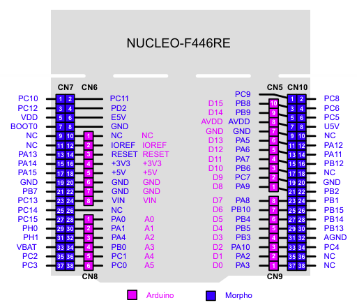
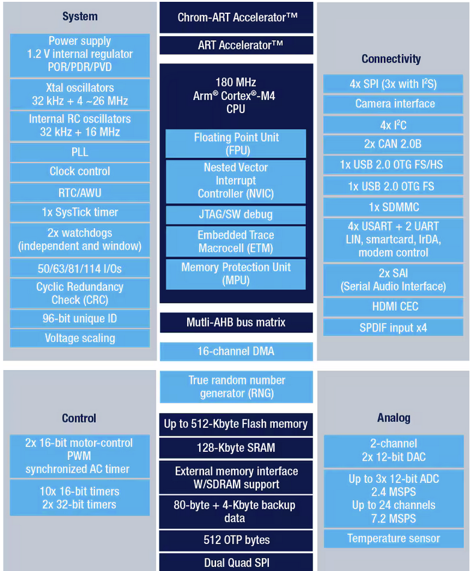

# STM32 Starlet ECU

4E-FTEエンジン向けの制御ECUをSTM32上に開発するプロジェクトです。最終的には純正ECUを置き換え、センサ入力に基づく燃料噴射・点火制御を目指します。

## 開発ターゲット

- 試作ボード: ST NUCLEO-F446RE
- MCU: STM32F446RET6
- 言語: C11
- ビルドシステム: CMake、Ninja、GNU Arm Embedded Toolchain

ボードのコネクタとMCU端子の対応は[ピンマップ](hardware/pinmap.md)を参照してください。ECU機能の端子割当、要求、未確定事項は[ECU要求仕様書](Docs_design/ECU_Requirements_Specification.md)に記載しています。





## 現在の開発状況

現在は試作段階です。NE/G1/G2からクランク位置を推定する同期処理、実際のインジェクタ駆動、IGT点火制御、ISCV制御はまだ完成していません。ADCサンプリングやGPIOトグル等の試作コードが含まれており、実機用制御ファームウェアではありません。

## ビルド

必要なツールをインストールし、`cmake`、`ninja`、`arm-none-eabi-gcc`がPATHから実行できるようにしてください。

- CMake 3.22以降
- Ninja
- GNU Arm Embedded Toolchain (`arm-none-eabi-gcc`、`arm-none-eabi-g++`、`arm-none-eabi-objcopy`等)

リポジトリのルートでDebugビルドを実行します。

```sh
cmake --preset Debug
cmake --build --preset Debug
```

Releaseビルドは次のとおりです。

```sh
cmake --preset Release
cmake --build --preset Release
```

ELF成果物は`build/Debug/stm32_starlet_ecu.elf`または`build/Release/stm32_starlet_ecu.elf`に生成されます。現在の設定には書き込み・実機動作確認の手順は含まれていません。

## 安全上の注意

**現状のファームウェアをインジェクタ、イグナイタ、車載ハーネスまたはエンジンへ接続しないでください。** 試作用のGPIOトグルがPC10（点火信号候補）やPB7（インジェクタ出力候補）を駆動し、ADCチャンネルも実センサの端子割当と一致していません。車載センサやアクチュエータを接続する前に、要求仕様書の端子整合レビューを確認してください。

開発初期の確認は、信号発生器と模擬負荷を使うベンチ試験を前提とします。同期喪失時や過回転時の出力動作には安全審査が未完了の項目があり、実機で有効化できる仕様として承認されていません。

## ドキュメント

- [ECU要求仕様・開発ステップ・端子整合レビュー](Docs_design/ECU_Requirements_Specification.md)
- [NUCLEO-F446RE ピンマップ（Markdown）](hardware/pinmap.md)
- [NUCLEO-F446RE ピンマップ（CSV）](hardware/pinmap.csv)
- [STM32CubeMX設定](stm32_starlet_ecu.ioc)
- [NUCLEO-F446RE ユーザーマニュアル](Docs_mcu/um1724-stm32-nucleo64-boards-mb1136-stmicroelectronics-1.pdf)
- [STM32F446xx リファレンスマニュアル](Docs_mcu/rm0390-stm32f446xx-advanced-armbased-32bit-mcus-stmicroelectronics.pdf)
