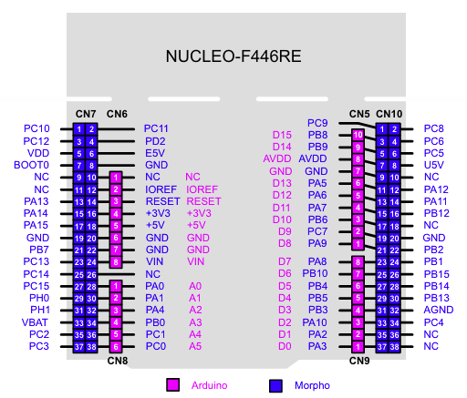
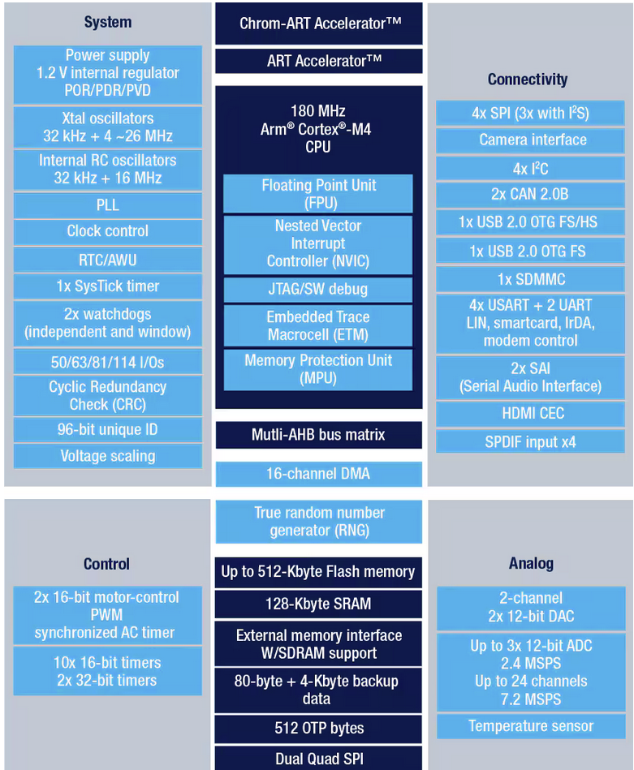

# STM32 Starlet ECU

4E-FTEエンジン向けの制御ECUをSTM32上に開発するプロジェクトです。最終的には純正ECUを置き換え、センサ入力に基づく燃料噴射・点火制御を目指します。

## 開発ターゲット

- 試作ボード: ST NUCLEO-F446RE
- MCU: STM32F446RET6
- 言語: C11
- ビルドシステム: CMake、Ninja、GNU Arm Embedded Toolchain

ボードのコネクタとMCU端子の対応は[ピンマップ](hardware/pinmap.md)を参照してください。ECU機能の端子割当、要求、未確定事項は[ECU要求仕様書](Docs_design/ECU_Requirements_Specification.md)に記載しています。





## 現在の開発状況

同期コア・ベンチ用GPIO取得に加え、TDC校正角、回転数換算、テーブル補間、燃料分配、論理噴射予約を実装しています。ADCはセンサ別の生値と取得成否を公開し、PC10/PB7の試作用トグルは無効化しました。追加した計算・予約モジュールは実出力に未接続です。点火・ISCV・設定通信・Flash保存や物理量校正は未確定仕様の回答待ちで、実機用ファームウェアの完成を意味しません。

- [実装状況とAPIの利用契約](Docs_design/IMPLEMENTATION_STATUS.md)
- [仕様追加確認リスト](Docs_design/IMPLEMENTATION_CONFIRMATIONS.md)

## ビルド

必要なツールをインストールし、`cmake`、`ninja`、`arm-none-eabi-gcc`がPATHから実行できるようにしてください。

- CMake 3.22以降
- Ninja
- GNU Arm Embedded Toolchain (`arm-none-eabi-gcc`、`arm-none-eabi-g++`、`arm-none-eabi-objcopy`等)

HAL/CMSISとstartupはSDK依存です。クリーン環境では、STM32CubeF4 v1.28.2を**サブモジュールを含めて**取得し、SDKパスを指定します（ソース生成による既存コードの上書きは不要）。

```sh
git clone --branch v1.28.2 --depth 1 --recurse-submodules --shallow-submodules https://github.com/STMicroelectronics/STM32CubeF4.git ../STM32CubeF4
cmake --preset Debug -DSTM32CUBE_F4_PATH=../STM32CubeF4
cmake --build --preset Debug
```

既にCubeMX 6.14.1 / STM32Cube FW_F4 V1.28.2から生成した`Drivers/`と`startup_stm32f446xx.s`がある場合は、SDKパスを省略できます。再生成時はUSER CODE外の追加処理とCMake変更を差分で確認してください。依存SDKをリポジトリへ同梱する必要はありません。取得したSDKは独自のライセンスに従います。

Releaseビルドは次のとおりです。

```sh
cmake --preset Release -DSTM32CUBE_F4_PATH=../STM32CubeF4
cmake --build --preset Release
```

ELF成果物は`build/Debug/stm32_starlet_ecu.elf`または`build/Release/stm32_starlet_ecu.elf`に生成されます。現在の設定には書き込み・実機動作確認の手順は含まれていません。

## 安全上の注意

### GPIO同期入力のベンチビルド

`STARLET_SYNC_BENCH`は既定でOFFです。信号発生器用のGPIO同期取得を有効にする場合は次のようにビルドします。

```sh
cmake --preset Debug -DSTM32CUBE_F4_PATH=../STM32CubeF4 -DSTARLET_SYNC_BENCH=ON
cmake --build --preset Debug
```

NE=PC6/CN10-4の立下り割り込み、G1=PB8/CN10-3、G2=PB9/CN10-5、TIM5=1 MHzの時刻基準を使います。TIM2は既存試作処理用のままです。入力は整形済み3.3 V信号を前提とします。NE周期500〜100000 µs、停止250000 µsは信号発生器用の仮設定であり、実機用の確定値ではありません。通常構成へ戻す場合は`-DSTARLET_SYNC_BENCH=OFF`を指定します。

イベントキューは64件で、mainのADC試作処理の前後に同期サービスを実行します。`engine_sync_board_status()`で同期状態・キュー占有数・欠落数・停止回数を取得できます。詳細は[ソフトウェア設計書](Docs_design/ECU_Software_Design.md)を参照してください。

### 現状の接続制限

**現状のファームウェアをインジェクタ、イグナイタ、車載ハーネスまたはエンジンへ接続しないでください。** PC10/PB7の試作トグルと誤ADCチャネルは修正しましたが、出力ドライバ・非作動極性・センサ回路・実機校正は未確定です。追加計算・論理予約は実出力に接続していません。必要な回答は[確認リスト](Docs_design/IMPLEMENTATION_CONFIRMATIONS.md)に記載しています。

開発初期の確認は、信号発生器と模擬負荷を使うベンチ試験を前提とします。同期喪失時や過回転時の出力動作には安全審査が未完了の項目があり、実機で有効化できる仕様として承認されていません。

## ドキュメント

- [ECU要求仕様・開発ステップ・端子整合レビュー](Docs_design/ECU_Requirements_Specification.md)
- [ECUソフトウェア設計（GPIO入力・割り込み・同期処理）](Docs_design/ECU_Software_Design.md)
- [NUCLEO-F446RE ピンマップ（Markdown）](hardware/pinmap.md)
- [NUCLEO-F446RE ピンマップ（CSV）](hardware/pinmap.csv)
- [STM32CubeMX設定](stm32_starlet_ecu.ioc)
- [NUCLEO-F446RE ユーザーマニュアル](Docs_mcu/um1724-stm32-nucleo64-boards-mb1136-stmicroelectronics-1.pdf)
- [STM32F446xx リファレンスマニュアル](Docs_mcu/rm0390-stm32f446xx-advanced-armbased-32bit-mcus-stmicroelectronics.pdf)


## ホスト試験

C11コンパイラとPython 3があればSDK・CMakeなしで実行できます。

```sh
python3 tests/run_host_tests.py
```

詳細は[tests/README.md](tests/README.md)を参照してください。
